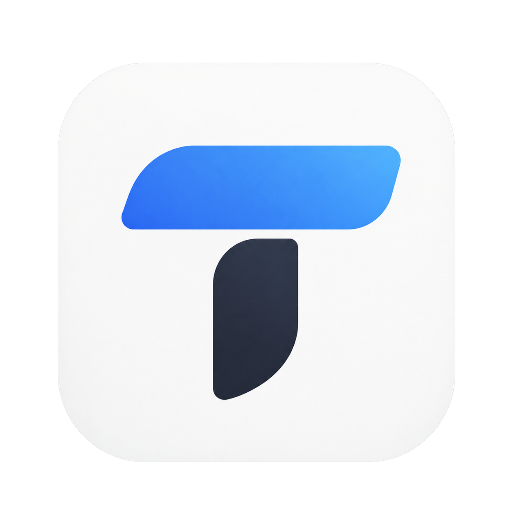

<div align="center">
  

  <h1>tuton-agent</h1>

  <p>
    <b>Pipeline otomatis mengerjakan soal tutorial online Universitas Terbuka</b><br/>
    dari scrape Moodle sampai dokumen jawaban <code>.docx</code> — lengkap
    dengan dashboard web real-time.
  </p>

  <p>
    
    
    
    
  </p>
</div>

---

Setiap sesi: ambil soal dari Moodle, tulis jawaban dengan agent AI, ambil
bahan ajar resmi sebagai referensi pertama, format persamaan jadi persamaan
Word asli, lalu rapikan Daftar Pustaka (penulis **tebal**, judul *miring*,
hanging indent).

## Pembaruan Terbaru

- **Grafik nilai di Dashboard** — kurva nilai per mata kuliah dari Diskusi &
  Tugas, digabung jadi satu garis mulus per course, dengan tab filter,
  legend interaktif, dan tooltip (jenis + sesi).
- **Browser mata kuliah + kalender jadwal** — klik baris mata kuliah untuk
  melihat chip sesi (jumlah soal) dan kalender bar `mulai → tenggat` tiap
  Diskusi/Tugas, lengkap dengan garis tenggat, weekend, navigasi bulan, dan
  tautan ke aktivitas Moodle.
- **Urutan menu dirapikan** — Dashboard → Courses → Kerjakan Tugas → Agent
  Worker → Result → Log Live → Pengaturan.
- **Ikon situs** — ikon tab browser dan `apple-touch-icon` untuk iPhone
  *Add to Home Screen* (full-bleed opaque, tanpa cincin putih di balik mask
  iOS).
- **Sesi login yang benar** — checkbox **ingat saya** (default aktif),
  modal konfirmasi sebelum keluar, logout benar-benar menghapus cookie dan
  kembali ke halaman masuk, plus guard rute: belum login tidak bisa membuka
  halaman aplikasi, sudah login tidak bisa melihat halaman login.
- **Cookie & cache selalu sinkron** — menyimpan cookie Moodle baru di menu
  Pengaturan langsung membersihkan seluruh cache turunannya (status login,
  nilai, jadwal, daftar course, halaman `cache/`) tanpa restart server;
  kalau cookie mati, select matkul dan dashboard menampilkan pesan error
  yang jelas, bukan daftar basi, dan hasil gagal cuma disimpan 30 detik.
- **Bersihkan log permanen** — tombol *Bersihkan* di Log Live ikut menghapus
  sumber replay (`events.jsonl` + buffer memori), sehingga log lama tidak
  muncul lagi saat halaman dimuat ulang. Di sebelahnya ada tombol *Hapus
  job* untuk membuang satu job beserta folder kerjanya.
- **Nama dokumen mengikuti jenis kegiatan** — berkas keluar dengan pola
  `Nama_Matakuliah_Jenis.nomor.docx` (mis. `Basis_Data_64_Tugas.3.docx`,
  `Basis_Data_64_Diskusi.3.docx`), memakai **nomor Diskusi/Tugas**, bukan
  nomor sesi, dan semua tanda hubung pada slug diganti garis bawah.
- **Filter jenis saat menjalankan agent dari Moodle** — select *Jenis* di
  form Kerjakan Tugas: *Otomatis (ikut sesi)*, *Tugas*, atau *Diskusi*.
  Pilihan menyaring soal sesi itu saja; kalau tidak ada soal yang cocok,
  job berhenti dengan pesan jelas, bukan menghasilkan dokumen salah jenis.
- **Pratinjau DOCX di Result** — klik nama berkas untuk membuka modal
  berisi isi dokumen (judul, daftar, tabel, gambar) tanpa mengunduhnya.
- **Hapus dari Result** — tombol sampah per berkas dan per mata kuliah
  (menghapus seluruh folder `output/<slug>/`), selalu lewat modal
  konfirmasi.
- **Mode gelap** — sakelar di Pengaturan, konsisten di seluruh aplikasi
  (kartu, tabel, grafik, modal, konsol), tersimpan per peramban dan sudah
  dipasang sebelum halaman digambar supaya tidak ada kilatan putih.
- **Result, log, dan input dipoles** — tab Result membaca dokumen langsung
  dari disk `output/`, Log Live konsol gelap real-time via SSE, mode Input
  Manual dengan pilih mata kuliah & unggah berkas, pemilih model tiap agent
  kini punya pencarian di dalam dropdown.

## Persyaratan

- Python 3.10+ (`py` launcher di Windows, atau `python`/`python3` langsung)
- Endpoint **OpenAI-compatible** (base URL, API key, dan daftar model) —
  diatur dari menu **Provider** di UI, tidak perlu memasang CLI tambahan
- Akun Moodle UT (`elearning.ut.ac.id`) dengan cookie login yang masih hidup
- Paket Python: `pip install -r requirements.txt`

## Menyiapkan Provider

Runtime agent berjalan di dalam aplikasi (Python), memakai API
`/chat/completions` yang kompatibel dengan OpenAI. Tidak memerlukan CLI eksternal.

1. Jalankan UI, buka menu **Provider**.
2. Isi nama, base URL (mis. `https://9router.example/v1`), API key, lalu tekan
   **Tes & ambil model** untuk mengambil daftar model dari `/v1/models`.
3. Simpan. Di kartu **Model per agent**, pilih model untuk `scrapper`,
   `research`, `worker`, dan `vision` (vision wajib model yang bisa membaca
   gambar). Biarkan kosong untuk memakai `PRIMARY_MODEL`/`VISION_MODEL` dari
   `.env`.

Provider, API key, model agent, dan server MCP disimpan di `runtime/runtime.json`
(mode `0600`, masuk `.gitignore`). API key tidak pernah dikirim balik ke
browser; saat mengubah provider, kosongkan kolom API key untuk mempertahankan
nilai lama.

Model cadangan di `FALLBACK_MODELS` (dipisah koma, bentuk
`provider/model`) dicoba otomatis kalau provider menolak model utama — kuota
habis, model tidak tersedia, atau autentikasi gagal.

## Setup Project

```powershell
cd E:\DEVOPS\AI\joki-tuton
py -m pip install -r requirements.txt
copy .env.example .env   # kalau .env belum ada; kalau sudah, lewati
```

Isi `.env`:

```text
URL_MOODLE=https://elearning.ut.ac.id

# Login dashboard (Clerk)
NEXT_PUBLIC_CLERK_PUBLISHABLE_KEY=pk_live_...
CLERK_SECRET_KEY=sk_live_...

# Profil per akun (Supabase)
SUPABASE_URL=https://<project>.supabase.co
SUPABASE_SERVICE_KEY=sb_secret_...
```

Lalu jalankan `supabase/migrations/0001_user_identities.sql` di Supabase SQL
Editor. Aplikasi ini **multi-user**: setiap akun Clerk punya cookie Moodle,
identitas DOCX, folder kerja, dan hasil sendiri di tabel
`public.user_identities`.

Isi `COOKIE_MOODLE` per akun melalui menu **Pengaturan** setelah login. Salin
nilai cookie `MoodleSession` dari browser (DevTools → Application → Cookies
untuk `elearning.ut.ac.id`). Menyimpan cookie baru langsung mengaktifkannya —
cache lama akun itu dibersihkan otomatis, tidak perlu restart.

`COOKIE_MOODLE` di `.env` hanya dipakai sebagai cadangan untuk pemakaian CLI
(`python main.py`); aplikasi web tidak pernah membacanya untuk akun mana pun.

## Menjalankan (CLI)

**Interaktif (pilih mata kuliah di menu):**

```powershell
py .\main.py
```

atau dobel klik `runner.bat`.

**Semua mata kuliah, satu sesi yang sama:**

```powershell
py .\main.py --semua --sesi 4
```

**Satu mata kuliah, satu sesi:**

```powershell
py .\main.py --matkul "Aljabar Linear Elementer" --sesi 4
```

**Lain-lain:**

```powershell
py .\main.py --daftar           # tampilkan semua course + sesi yang punya soal
py .\main.py --tanpa-docx       # hasilkan jawaban.md saja
py .\main.py --tanpa-gambar     # lewati transkripsi gambar oleh model vision
runner.bat --semua --sesi 4     # sama seperti di atas via batch
```

## Antarmuka Web (UI)

Pipeline ini punya antarmuka web lokal yang ringan (murni Python standard
library, tanpa dependency baru) supaya proses bisa dipantau lewat dashboard,
termasuk **log real-time** tiap tahap agent.

### Menjalankan UI

Windows:

```powershell
py server/app.py
# atau: runner_web.bat
```

Linux:

```bash
python3 server/app.py
```

Lalu buka <http://127.0.0.1:8000> (atau `WEB_PORT` di `.env`). Server
mendengarkan `127.0.0.1` secara default; ganti `WEB_HOST` ke `0.0.0.0`
hanya bila perlu diakses dari LAN.

### Menu

Urutan menu sesuai tampilan aplikasi:

| Menu             | Isi                                                                 |
|------------------|---------------------------------------------------------------------|
| **Dashboard**    | Status Moodle, jumlah provider/model, Python/platform, ringkasan, **grafik nilai** |
| **Courses**      | Daftar mata kuliah — klik barisnya untuk chip sesi + kalender jadwal |
| **Kerjakan Tugas** | Dari Moodle (pilih course, sesi, dan **jenis: Otomatis/Tugas/Diskusi**) atau **Input Manual** (teks soal + unggah berkas; output rapi per `output/<slug>/sesi-<N>/`) |
| **Agent Worker** | Keempat agent (scrapper, research, vision, worker) beserta model yang dipakai |
| **Provider**     | CRUD provider OpenAI-compatible, tes koneksi, ambil `/v1/models`, dan model per agent |
| **MCP**          | Server MCP remote (streamable HTTP): URL, header, tes + daftar tool, pilih agent yang boleh memakainya |
| **Skill**        | Unggah, sunting, dan hapus `SKILL.md` di `skills/<nama>/` |
| **Result**       | Daftar dokumen hasil dari disk `output/` — **klik untuk pratinjau**, unduh, hapus berkas, atau hapus seluruh mata kuliah |
| **Log Live**     | Konsol log real-time per job (Server-Sent Events; bisa disegarkan karena event tersimpan di `<job>/events.jsonl`), bersihkan log atau **hapus job** |
| **Pengaturan**   | Edit `.env`, termasuk cookie Moodle (cookie & password disensor) + **mode gelap** |

### Grafik nilai

- Nilai diambil **hanya dari Diskusi & Tugas**, dipetakan ke sesi dengan
  aturan: Diskusi *n* → sesi *n*, Tugas *n* → sesi *2n + 1*.
- Tiap mata kuliah jadi satu garis melengkung yang menyatu rapi: titik penuh
  untuk Diskusi, cincin untuk Tugas, warna mengikuti tema.
- Ada tab filter per course, legend yang bisa dimatikan, dan tooltip gelap
  yang menampilkan jenis, sesi, dan nilainya.
- Data sukses di-cache 10 menit (`/api/nilai`) supaya dashboard tetap
  ringan; hasil error cuma 30 detik supaya perbaikan cookie langsung
  terbaca.

### Kalender jadwal

- Satu baris besar di bawah chip sesi: bar `mulai → tenggat` untuk tiap
  Diskusi/Tugas — biru muda untuk Diskusi, kuning muda untuk Tugas.
- Garis tenggat vertikal tipis di ujung kanan bar (tanpa titik/ornamen),
  angka hari tenggat ditebalkan.
- Bar yang rentangnya tumpang tindih otomatis antre di lane berbeda,
  akhir pekan disorot halus, ada penanda hari ini, navigasi bulan, dan
  tooltip saat hover.
- Klik bar untuk langsung membuka aktivitas Moodle-nya. Tanggal mulai forum
  yang tidak terbaca dari Moodle diturunkan dari tenggat sebelumnya (ditandai
  `mulai_turunan` di tooltip). Data sukses di-cache 10 menit
  (`/api/jadwal/<course_id>`); hasil error cuma 30 detik.

### Ikon & Add to Home Screen

<p align="center">
  
  &nbsp;&nbsp;&nbsp;
  
</p>
<p align="center"><sub><code>icon.png</code> · <code>apple-touch-icon.png</code> (180×180)</sub></p>

- Ikon tab browser memakai `icon.png` apa adanya; iPhone memakai
  `apple-touch-icon.png` saat ditambahkan ke layar utama.
- `apple-touch-icon` sengaja dibuat **penuh dan opaque** (tanpa kanal alpha,
  area transparan sudah dipotong ke bidang solid berwarna sama dengan latar
  ikon) karena iOS mengabaikan alpha dan menerapkan mask-nya sendiri —
  kalau ikonnya di-flatten ke putih, muncul cincin putih di sekeliling ikon.
- Berkas gambar disajikan dengan `Cache-Control: max-age=86400`. Kalau ikon
  diganti, hapus dulu ikon lama dari layar utama iPhone lalu tambahkan
  ulang, dan refresh keras halaman web (Ctrl+F5) untuk ikon tab.

### Keamanan & sesi

- **Ingat saya** dicentang secara default: sesi bertahan **30 hari**;
  tanpa centang, sesi mengikuti browser (maksimum 12 jam).
- **Keluar** memakai modal konfirmasi (Esc/batal untuk batal). Setelah
  dikonfirmasi, cookie dihapus (`Max-Age=0`), cache data dikosongkan, dan
  tampilan kembali ke halaman masuk.
- **Guard rute (middleware di klien)**: semua rute memeriksa sesi dulu —
  belum login, halaman aplikasi mana pun (termasuk via URL `#hash` langsung)
  akan ditahan di halaman masuk; sudah login, halaman masuk langsung
  dialihkan ke dashboard. Sesi dicek ke server lewat `/api/session` (tanpa
  cache) saat aplikasi dibuka.
- Semua endpoint `/api/*` (kecuali `/api/session`) membalas `401` tanpa
  cookie valid, dan UI otomatis kembali ke halaman masuk saat menerimanya.
- **Pagar cookie Moodle**: endpoint yang menyajikan data Moodle (`/api/courses`,
  sesi, jadwal, nilai, dan submit scrape) memeriksa sesi Moodle lebih dulu —
  cookie mati langsung ditolak dengan pesan jelas, bukan data basi dari
  cache. Menyimpan cookie baru di **Pengaturan** membersihkan semua cache
  terkait otomatis tanpa restart.

## Menjalankan dengan Container

Repo sudah punya `Dockerfile` dan `docker-compose.yml` (Podman/Docker):

```bash
podman-compose up -d --build --force-recreate   # atau: docker compose up -d --build
./.restart.sh                                    # redeploy + cek sehat (Podman + nginx)
```

Catatan:

- Di container, `WEB_HOST=0.0.0.0` dan `WEB_PORT=5000` (di-override di
  compose; `.env` yang di-bind tidak diubah) di belakang nginx.
- Folder `output/`, `_kerja/`, `cache/`, dan `.env` di-bind ke host supaya
  hasil dan jejak job tetap ada walau container dibuat ulang.
- `.restart.sh` adalah cara resmi redeploy project ini (bikin ulang image,
  sambungkan ulang container ke `app-network`, tunggu siap, lalu verifikasi
  jalur nginx). Script ini tidak pernah me-restart nginx.
  `./restart.sh` (tanpa titik) masih ada sebagai shim ke `.restart.sh`.

## Hasil

- Jawaban: `output/<slug>/sesi-<N>/<slug dengan garis bawah>_<Jenis>.<nomor>.docx`

  | Kegiatan           | Nama berkas                       |
  |--------------------|-----------------------------------|
  | Tugas 3            | `Basis_Data_64_Tugas.3.docx`      |
  | Diskusi 3          | `Basis_Data_64_Diskusi.3.docx`    |
  | Diskusi & Tugas    | `Basis_Data_64_Diskusi_Tugas.3.docx` (nomor sesi) |

  Angka setelah titik adalah **nomor Diskusi/Tugas**, bukan nomor sesi
  (Diskusi *n* → sesi *n*, Tugas *n* → sesi *2n + 1*). Kalau nomor tidak
  bisa dibaca dari nama kegiatan, dipakai nomor sesinya. Berkas dengan nama
  lama (`<slug>-sesi-<N>.docx`) tetap dikenali, jadi sesi yang sudah
  selesai tidak dikerjakan ulang.
- Kerja: `_kerja/<slug>/sesi-<N>/` (peta soal, transkrip, lampiran, log)

Log tiap tahap ada di `_kerja/.../_log/`. Kalau satu course gagal di mode
`--semua`, yang berikutnya tetap berjalan dan ringkasan akhir menampilkannya.

## Struktur

| Folder/berkas       | Fungsi                                            |
|---------------------|---------------------------------------------------|
| `main.py`           | Antarmuka baris perintah                          |
| `tuton/`            | Paket inti: pipeline, klien Moodle, agent runner, provider, tools, MCP, konfigurasi |
| `tools/docx.py`     | Renderer DOCX: equation Word, daftar pustaka, template |
| `server/app.py`     | Server HTTP + API (login, nilai, jadwal, job, SSE, provider/MCP/skill) |
| `server/static/`     | Hasil build UI; di image Docker diisi dari `frontend/out/` |
| `frontend/`          | Sumber UI Next.js (static export ke `frontend/out/`) |
| `runtime/runtime.json` | Provider, API key, model agent, server MCP (dibuat dari menu, mode 0600) |
| `agents/`            | Spec prompt agent statis: scrapper, worker, research, vision |
| `skills/`            | Skill Markdown yang dapat dimuat agent |
| `Dockerfile` + `docker-compose.yml` + `.restart.sh` | Build image dan redeploy container |
| `runner.bat`        | Shortcut Windows                                  |

## Multi-user

Setiap akun Clerk adalah tenant sendiri:

| Data | Lokasi | Keterangan |
|------|--------|------------|
| Cookie Moodle | `user_identities.cookie_moodle` | Per akun; tidak pernah dikirim balik ke klien |
| Identitas DOCX (nama, NIM, semester, UT-Daerah, prodi) | `user_identities.*` | Per akun |
| Hasil DOCX | `output/<user_id>/<matkul>/sesi-<N>/` | Terisolasi per akun |
| Folder kerja & log job | `_kerja/<user_id>/<slug>/sesi-<N>/` | Terisolasi per akun |
| Cache HTML Moodle | `cache/<user_id>/` | Halaman berisi data akun |
| Provider/model/MCP | `runtime/runtime.json`, `.env` | Sengaja bersama: API key tidak diduplikasi per user |

Job lama yang masih berjalan saat deploy tetap memakai profil pemiliknya
(cookie/identitas disimpan di objek job saat dibuat), jadi memperbarui
pengaturan tidak mengubah job yang sedang berjalan.

### Supabase keepalive

Supabase gratis mem-pause project setelah 7 hari tanpa aktivitas. Server
menjalankan thread keepalive yang memanggil `GET /rest/v1/tuton_keepalive`
tiap 6 jam, plus satu sentuhan setiap request terautentikasi. Statusnya
terlihat di `GET /api/status` (`keepalive`).

### Memindahkan hasil sebelum multi-user

Hasil lama ada di `output/<matkul>/...` dan tidak terlihat oleh akun mana pun
sekarang. Pindahkan ke akun yang benar:

```powershell
py tools/migrasi_output.py --daftar
py tools/migrasi_output.py --user user_XXXXXXXX --dry-run
py tools/migrasi_output.py --user user_XXXXXXXX
```

## Catatan keamanan

- Semua HTTP ke Moodle lewat proxy lokal `reader.py`; tidak ada cookie atau
  token yang ditulis ke berkas yang diserahkan ke tutor.
- Token Reader (`?k=`) disaring dari log dan peta soal.
- Login memakai Clerk; API memverifikasi token Bearer ke Clerk setiap
  request (di-cache 60 detik). Tidak ada sesi yang disimpan sendiri di server.
- Cookie Moodle dan identitas tersimpan per akun di Supabase; RLS tabel
  `user_identities` ditutup total untuk `anon`/`authenticated`, hanya service
  key server yang bisa membaca.
- `COOKIE_MOODLE` tidak pernah dikirim mentah ke klien — halaman Pengaturan
  hanya menampilkan empat huruf terakhir.
- Setiap job, daftar hasil, dan unduhan difilter berdasarkan pemilik (id
  user Clerk); job milik akun lain menjawab 404, bukan 403, agar
  keberadaannya tidak bocor.

## Kalau gagal

Ikuti urutan ini:

1. `_kerja/<slug>/sesi-<N>/_log/*.log` — cari baris `= langkah selesai` terakhir.
2. Kalau peta soal gagal: lihat `scrapper.log` — kemungkinan forum-nya
   lembar kosong (cek apakah soalnya di resource/lampiran forum).
3. Kalau persamaan di Word merah/mentah: jalankan ulang hanya tahap docx
   dengan menghapus `output/.../file.docx`.
4. Paksa pengerjaan ulang satu sesi: hapus `_kerja/<slug>/sesi-<N>/_jawaban/jawaban.md`
   dan berkas `.docx` tujuan.
5. UI terasa basi setelah update: refresh keras (Ctrl+F5) — aset gambar
   di-cache server selama 1 hari.
